## NGS Automated Variant Calling Pipeline

**A Python-based Next-Generation Sequencing (NGS) pipeline that finds variants in bacterial and viral genomes, from raw reads to an interactive results dashboard.**



### Start here

| # | Read | For |
|---|------|-----|
| 1 | [workflow_diagram.svg](workflow_diagram.svg) | The big picture: every step and why it's there |
| 2 | [Prerequisites.md](Prerequisites.md) | One-time install (Miniforge, the `ngs-env` environment, SnpEff database) |
| 3 | [workflow_run.md](workflow_run.md) | How to run it and fix common problems |
| 4 | [reading_results.md](reading_results.md) | How to read the dashboard and judge a sample, with a worked example |
| 5 | [integrate_claude.md](integrate_claude.md) | Optional: using Claude Code to run or extend the workflow |

---
### Prerequisites
Before running the setup script, make sure you have installed all [Prerequisites](Prerequisites.md).


### Three ways to run it

All three run the **same steps** with the same settings, because the Snakemake rules and the Nextflow processes call the functions in the interactive script. On the same input they give identical results.

| | Interactive script | Snakemake workflow | Nextflow pipeline |
|---|---|---|---|
| Command | `python3 run_interactive_pipeline.py` | `snakemake -s workflow/Snakefile -c 4` | `bash workflow/run_nextflow.sh` |
| Input | 4 questions, each with examples | `config/config.yaml` (list of samples) | the same `config/config.yaml` |
| Samples | 1 per run | Many, in parallel | Many, in parallel |
| Re-run | Repeats every step | Only redoes what's missing; resumes after a crash | `-resume` reuses finished steps |
| Output folder | `NGS_run/` | `results/` | `results_nf/` (+ `pipeline_info/` run report) |
| Runs on | This machine | This machine (or a cluster with a profile) | This machine, SLURM/PBS or the cloud: change `executor` in `workflow/nextflow.config` |

### Languages: who does what

| Language | Where | Job |
|---|---|---|
| **Python** + **Polars** | `run_interactive_pipeline.py`, `dashboard.py` | Runs the tools, builds the variant tables (Polars), builds the dashboard |
| **R** (base R only) | `R/variant_stats.R` | Statistical tests on the calls: Ts/Tv with 95% CI, Wilcoxon, Spearman, KS, Poisson hotspot windows |
| **Snakemake** / **Nextflow** | `workflow/Snakefile`, `workflow/main.nf` | Run the steps for many samples, in parallel and resumable |
| **HTML/JavaScript** | inside `dashboard.html` | Interactive charts and tables, no internet needed |

### Input options

1. **Public SRA data:** enter a run accession such as `SRR1553607`. It is looked up on ENA straight away and a summary is shown before anything is downloaded: organism, paired or single-end, read count, download size, and the reference that will be used. A typo is caught here and you're asked again. The reads are then downloaded from ENA over HTTPS.
2. **Your own FASTQ files:** enter the path to the R1 file. R2 is found automatically (`_R1`→`_R2`, `_1`→`_2`, `_R1_001`→`_R2_001`), and both files are read once for a summary: reads, bases, read length, GC and quality. You also give a reference accession, because local files carry no organism name.

The reference genome is chosen from the organism name, for example E. coli, Salmonella, S. aureus, M. tuberculosis, Ebola viruses or SARS-CoV-2. You can also give any RefSeq accession, such as `NC_002549.1`, which is checked on NCBI before the run starts. At question 4:
- type **`list`** to see every built-in reference and pick one by number;
- type **`0`** to map a sample of your reads against all of them and get the best match (see [workflow_run.md](workflow_run.md#4-start-the-pipeline)).

---

### Biological & analytical rationale

- **Integrated QC & trimming:** **fastp** trims adapters, filters low-quality reads and corrects bases in one pass.
- **Careful variant calling:** **BCFtools** counts only good evidence: reads with mapping quality ≥ 20 and bases with quality ≥ 20, up to 10,000 reads per position so deep data isn't cut off. It calls **haploid** (`--ploidy 1`), because bacteria and viruses carry one genome copy and diploid calling produces artifact heterozygous calls. Indels are **normalized** (`bcftools norm`), so the same variant is always written the same way.
- **Three-part confidence filter, flagged rather than deleted:** a call is PASS only if **QUAL ≥ 30, good-quality depth (DP) ≥ 15 and allele frequency (AF) ≥ 80%**. Failing calls keep a reason in the VCF FILTER column (`LowQual` / `LowDepth` / `LowAF`), so there's an audit trail of what was excluded and why. The AF rule catches mixed samples or contamination: in a haploid genome a real variant is in (nearly) all reads.
- **Functional annotation:** **SnpEff** predicts the effect of each variant (missense, synonymous, stop-gained, …). It runs only when a SnpEff database matching the reference is listed in `SNPEFF_DB`; by default that's E. coli K-12 `NC_000913.3`. Otherwise it is skipped with a clear warning.
- **Sample checks before alignment (best practice for clinical and unknown samples):**
  - *Reference screen* (on by default): 50,000 reads are mapped against every built-in genome at once, plus human rRNA/mitochondrial decoys. Each genome is scored by how **evenly** the reads cover it (observed ÷ expected spread). A genome that is really present gets reads all along it, while contaminants and conserved genes such as rRNA pile up in a few places. It lists every organism detected (mixed infections), flags divergent strains, and warns when the configured reference isn't what the reads match.
  - *Host removal* (optional): drops reads that map to a host genome (e.g. human).
  - *Kraken2 + Bracken* (optional): open-world classification against a large database.
  - *Negative controls*: samples marked `control: true` get only these checks. The dashboard then flags any finding that is less than 10× above the controls.
- **Readable results:** each run ends with a self-contained HTML dashboard showing quality checks, coverage, filters and a variant table. The CSV files can be viewed in the page (searchable *Data tables*) and also load into Power BI or Excel.
- **Disk use:** the large intermediate SAM file is deleted after sorting.

---

### Pipeline steps

| Step | Tool | Purpose | Why |
|------|------|---------|-----|
| 1 | Setup | Create numbered output folders | Results are easy to find; runs don't mix |
| 2 | Reference | Download the reference genome from NCBI | A known genome to compare reads against |
| 3 | Indexing | `bwa index`, `samtools faidx` / `dict` | Fast lookup of any position |
| 4 | Data input | ENA download or local FASTQ | Public or private data |
| 5 | fastp | QC, trimming, base correction | Errors and adapters would look like mutations |
| 5b | BWA-MEM + samtools (optional) | Remove reads that map to the host genome (`host_index`) | Faster, fewer false variants, no human data in the results |
| 5c | BWA-MEM (reference screen) | Map 50,000 reads against every built-in genome; rank by coverage evenness | Confirms the reads match the reference; shows mixed samples, contamination, divergent strains |
| 5d | Kraken2 + Bracken (optional) | Classify reads against a large database (`kraken_db`) | Open-world "what is in this sample?"; contamination check |
| 6 | BWA-MEM + samtools | Align, sort and index reads | Reads must be placed on the genome first |
| 7 | BCFtools | Haploid calling from good-quality reads (MAPQ/base Q ≥ 20), indels normalized | Finds where the sample differs from the reference, using only reliable evidence |
| 8 | SnpEff | Functional annotation (when available) | Shows whether a gene or protein changes |
| 9 | bcftools filter + Polars | Flag QUAL / depth / AF failures; PASS table + all-calls table | Keeps only well-supported variants, with a record of what was excluded and why |
| 9b | R (`R/variant_stats.R`) | Ts/Tv + 95% CI, PASS-vs-flagged tests, AF spread, even-spread test, hotspot windows | Checks that the filter works and that the variants look like real mutations; finds regions with more variants than chance |
| 10 | dashboard.py | HTML dashboard + CSV tables (incl. the R statistics) | Results at a glance in the browser; same tables ready for Power BI or Excel |

---

### Getting started

```bash
# 1. One-time setup: see Prerequisites.md (creates the ngs-env environment)

# 2. Activate the environment (every new terminal)
source ~/miniforge3/bin/activate ngs-env
cd ngs-variant-calling

# 3a. One sample, interactive
python3 run_interactive_pipeline.py
#     answers: SRR1553607 → 4 → Enter → NC_002549.1

# 3b. Or many samples with Snakemake (edit config/config.yaml first)
snakemake -s workflow/Snakefile -n      # dry run: shows what will run
snakemake -s workflow/Snakefile -c 4    # real run with 4 cores

# 3c. Or the same samples with Nextflow (same config file)
bash workflow/run_nextflow.sh           # results in results_nf/ (Nextflow's log, work and cache too)
bash workflow/run_nextflow.sh -resume   # after a crash or a change: reuse finished steps

# 4. View the dashboard in your browser (Codespaces)
python3 -m http.server 8000 --directory results/07_dashboard &   # NGS_run/07_dashboard for 3a
"$BROWSER" http://localhost:8000/dashboard.html      # results_nf/07_dashboard for 3c
```

---

### Outputs

Every run writes the same numbered folders: `NGS_run/` for the interactive script (by default), `results/` for Snakemake, or `results_nf/` for Nextflow.

| Folder | Contents |
|--------|----------|
| `00_raw/` | Downloaded reads |
| `01_reference/` | Reference FASTA + index files |
| `02_qc/` | Trimmed reads, `*.fastp.html` / `.json` quality reports · `*.reference_screen.tsv` · `*.host_removal.json` + host-removed reads (if on) · `*.kraken2.report` / `*.bracken_species.tsv` (if on) |
| `03_aligned/` | `*.sorted.bam` + `.bai` |
| `04_variants/` | `*.raw.vcf.gz`: all calls before filtering (with AD/DP per call) · `*.calling_settings.json`: the exact calling options used |
| `05_annotated/` | `*.ann.vcf.gz`: SnpEff-annotated VCF (when annotation runs) |
| `06_reports/` | `*.high_confidence_variants.tsv`: PASS calls (CHROM, POS, REF, ALT, QUAL, DP, AF, Effect, Impact, Gene, HGVS_c, HGVS_p) · `*.all_calls.tsv`: every call + FILTER reason · `*.flagged.vcf.gz`: VCF with FILTER set · `*.r_stats.tsv` / `*.r_windows.tsv`: R statistics and hotspot windows |
| **`07_dashboard/`** | **`dashboard.html`** (open in any browser, works offline), `sample_summary.csv`, `all_samples_variants.csv`, `all_samples_calls.csv`, `r_statistics.csv`, `variant_windows.csv`, `reference_screen.csv`, `taxonomy.csv`. All seven CSVs are also shown inside the page. |
| `pipeline_info/` | Nextflow only: `nextflow.log`, `report.html`, `timeline.html`, `trace.tsv` (time, CPU and memory per step) |
| `nextflow/` | Nextflow only: `work/` (one folder per task) and `cache/` (used by `-resume`); safe to delete when you no longer need `-resume` |

---

### Tools used

- **Data retrieval:** ENA Portal API + HTTPS (`requests`), NCBI Entrez (`biopython`)
- **QC & trimming:** fastp
- **Alignment:** BWA-MEM + samtools
- **Variant calling:** BCFtools (haploid)
- **Annotation:** SnpEff (OpenJDK)
- **Filtering & reporting:** Polars
- **Statistics:** R (base R, in its own `ngs-r` environment)
- **Sample checks:** BWA-MEM competitive mapping (reference screen, host removal); Kraken2 + Bracken (optional, in its own `ngs-kraken` environment)
- **Dashboard:** Python + a self-contained HTML/JavaScript page (no extra installs)
- **Workflow managers:** Snakemake or Nextflow (optional, for many samples)

---

### Known limitations

- Designed for haploid genomes (bacteria, viruses). For diploid organisms, remove `--ploidy 1`.
- Annotation is set up only for E. coli K-12 by default. Add other references to `SNPEFF_DB` after checking that the database matches.
- The Snakemake and Nextflow routes need paired-end reads; use the interactive script for single-end data.
- Host removal and Kraken2 need large databases that you supply (a bwa-indexed host genome of about 3 GB; Kraken2 Standard-8 needs about 8 GB RAM). Both are off until configured.
- The reference screen can only rank the built-in genomes. A novel or divergent organism (less than ~85% identity) won't be detected there; use Kraken2, or a protein-level search such as DIAMOND.
- No duplicate marking, primer trimming or consensus FASTA yet.
- Thresholds (QUAL 30, DP 15, AF 0.8) are common starting points, not validated for a specific assay. Validate them against samples with known variants before clinical or public-health use.

## License

The code and documentation in this repository are released under the [MIT License](LICENSE). The tools the pipeline runs (BWA, SAMtools, BCFtools, fastp, SnpEff, Snakemake, Nextflow, R, …) and the public data it downloads (ENA reads, NCBI references) keep their own licenses and terms. See [THIRD_PARTY_NOTICES.md](THIRD_PARTY_NOTICES.md) for the list, and cite those tools if you publish results.

## Author
Liam TrinhNguyen
   Data Scientist, Wisconsin State Laboratory of Hygiene (WSLH)
   Bioinformatics and Computational Biology, M.S.
