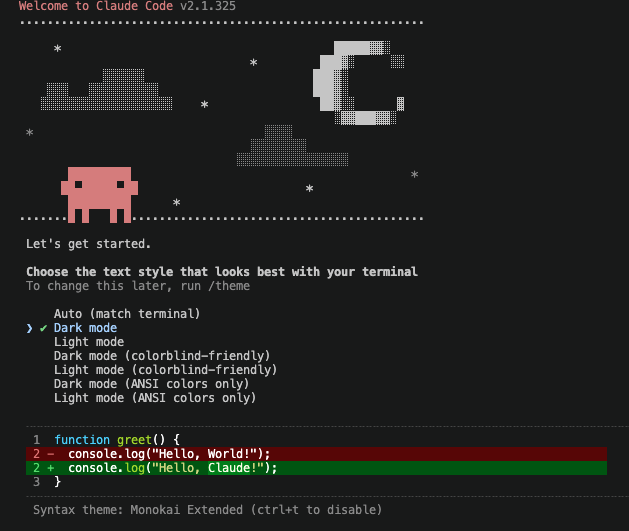

1. Install Claude Code (Anthropic's CLI for Claude):

```bash
npm install -g @anthropic-ai/claude-code
```

2. access claude and setup from terminal:
```bash
claude
```

<p align="center">
  
</p>

This will redirection to external to complete setup
<p align="center">
  
</p>

