# Reading the Results

This guide explains what the workflow does and how to read its results dashboard (`07_dashboard/dashboard.html`). The worked example is the Ebola sample **SRR1553607**, so the numbers below are what you'll see if you run it yourself.

- Installing the tools → [Prerequisites.md](Prerequisites.md)
- Running the workflow → [workflow_run.md](workflow_run.md)

---

## Part 1 · What the workflow does



In one sentence: **it compares your sequencing reads with a known reference genome and lists the positions where your sample is different, keeping only differences that are well supported.**

| Step | What happens | Why it matters for the result |
|------|--------------|-------------------------------|
| 1 · Setup | Creates folders `00_raw` … `07_dashboard` | Every result has a fixed place |
| 2–3 · Reference | Downloads the reference genome and indexes it | Variants are always *relative to this genome*. A distant reference gives many variants that are just normal strain differences. |
| 4 · Reads | Downloads reads from ENA (SRR…) or uses your FASTQ files | The raw material |
| 5 · QC (fastp) | Removes adapters, low-quality bases and very short reads | Sequencing errors would otherwise look like mutations |
| 6 · Alignment (BWA-MEM) | Places each read where it belongs on the genome | You can only compare reads once they're lined up |
| 7 · Calling (bcftools) | At each position, counts the bases in **good-quality** reads (mapping quality ≥ 20, base quality ≥ 20) and decides whether the sample differs from the reference. **Haploid**: one genome copy, as in bacteria and viruses. | Produces the *raw calls*, every candidate difference |
| 8 · Annotation (SnpEff) | Adds the gene and the effect (e.g. missense) | Only runs if a matching database is set up (E. coli K-12 by default). Skipped for Ebola. |
| 9 · Flag & report | Marks each call **PASS** or with the reasons it failed: `LowQual`, `LowDepth`, `LowAF` | Separates trustworthy variants from weak ones, and keeps a record of both |
| 9b · Statistics (R) | Runs statistical tests on the calls: Ts/Tv with a confidence interval, PASS vs flagged, even spread, hotspot windows | Turns "how many" into "is it real, and where": see 3.12 |
| 10 · Dashboard | Builds one HTML page plus CSV tables | What this guide explains |

### The three rules a variant must pass

A raw call becomes a **trusted variant** (PASS) only if **all three** are true:

| Rule | Measures | Threshold | If it fails | What failing usually means |
|------|----------|-----------|-------------|----------------------------|
| **QUAL** | How confident the caller is | ≥ 30 (about 1 in 1,000 chance of being wrong) | `LowQual` | Weak or conflicting evidence |
| **DP** (depth) | How many good-quality reads cover the position | ≥ 15 | `LowDepth` | Too few reads to be sure. Sequence deeper. |
| **AF** (allele frequency) | What share of those reads show the variant | ≥ 80% | `LowAF` | Reads disagree: a mixed sample, contamination, or reads from a related genome mapping here |

Calls that fail are **flagged, not deleted**. You can always see what was excluded and why.

---

## Part 2 · Opening the dashboard

In Codespaces, run:

```bash
cd /workspaces/Bioinformatic_workflow/ngs-variant-calling
python3 -m http.server 8000 --directory results/07_dashboard &   # interactive runs: NGS_run/07_dashboard
"$BROWSER" http://localhost:8000/dashboard.html
```

You can also right-click `dashboard.html` → **Download** and double-click it. It works offline, and you can email it.

**Read it from top to bottom.** The page is laid out in the order you should ask the questions:

1. **Is the sample good enough?** → tiles + quality checks
2. **How many variants, and how were they filtered?** → funnel, filter reasons
3. **Can I trust the calls?** → depth plot, QUAL/depth plot, allele frequency
4. **What are the variants?** → types of change, variant table
5. **Are the patterns real, and where are they?** → "Statistics from R"
6. **Was it run correctly?** → "How the variants were called"
7. **I need the numbers** → data tables / CSV

---

## Part 3 · Section by section

### 3.1 Header and sample selector

`1 sample · reference NC_002549.1 (Zaire ebolavirus … Yambuku-Mayinga) · 18,959 bp`

- **Reference:** everything is compared with this genome. Here it's the 1976 Mayinga strain, while SRR1553607 comes from the 2014 West Africa outbreak. Many of the differences you'll see are the normal ~40 years of evolution between strains, not anything unusual.
- **Sample selector:** with several samples, choose which one the page shows.
- **All samples table** (only with 2+ samples): one row per sample with a status badge. Click a row to switch. Use it to spot the odd one out.

### 3.2 Tiles: the headline numbers

| Tile | SRR1553607 | How to read it |
|------|-----------|----------------|
| **Reads after QC** | 336,142 of 406,890 | 83% survived trimming, which is normal. Below ~70% means poor sequencing quality. |
| **Mapped to reference** | 1.2% | Share of reads that belong to this genome. See 3.3; this is the important one here. |
| **Mean read depth** | 15.7× | Average number of good-quality reads per position. Compare it with the 15× needed to keep a variant. |
| **Genome covered** | 99.0% | Share of the genome seen by at least one good read. Close to 100% means no large gaps. |
| **Trusted variants** | 151 of 559 calls | 151 passed all three rules. 151 SNPs, 0 indels. |

### 3.3 Quality checks: "Is this sample good enough?"

Each check shows **✓ OK** (green) or **! Check** (amber) with a one-line explanation.

| Check | OK when | SRR1553607 | Meaning |
|-------|---------|-----------|---------|
| Reads passing QC | ≥ 80% | ✓ 82.6% | Sequencing quality is fine |
| Reads mapped to the reference | ≥ 50% | **! 1.2%** | Almost all reads are *not* Ebola |
| Mean read depth | ≥ 15× | ✓ 15.7× | Just enough on average (see 3.5: the average hides thin regions) |
| Genome covered | ≥ 90% | ✓ 99.0% | No big gaps |
| Mixed calls (AF 20–80%) | ≤ 5 | ✓ 0 | Reads agree with each other: one clean genome, no sign of a mixture |
| Annotation | — | – Skipped | No SnpEff database is set up for this reference |

**How to judge "! Check" for mapping:** SRR1553607 is RNA from a patient sample, so most reads are human or other organisms. **For clinical metagenomic samples this is expected.** For a pure bacterial culture it would be a red flag: the wrong organism, contamination, or the wrong reference. The low mapping rate is also why depth is only about 16×: 98.8% of the sequencing went to other organisms.

### 3.3b Sample identity & contamination: "Is this the organism I think it is?"

This card shows the sample checks that run before alignment (see [workflow_run.md §6b](workflow_run.md#6b-sample-checks-screen-host-removal-kraken2-controls)). It only appears if at least one check ran. Its warnings also count towards the sample's status badge in the *All samples* table.

| Check | OK when | SRR1553607 | Meaning |
|-------|---------|-----------|---------|
| Host reads removed | (information) | 0.1% with the small rRNA+mito test index | How much of the sample was host; the rest went on to alignment |
| Reads match the reference | the best evenly-covered genome *is* the reference | ✓ Zaire ebolavirus | The variants were called against the right genome |
| More than one organism | only shown when ≥ 2 genomes are covered evenly | – | Mixed infection or contamination |
| Divergent relative | only shown when 85–95%-identity reads cover a genome evenly | – | A strain too far from the reference: variant calls would be unreliable |
| Also in the negative control | only shown with controls | – | The finding is below 10× the control's level: likely contamination |
| Most abundant species (Kraken2) | (information) | Orthoebolavirus zairense, 79% of classified reads | An independent, database-wide answer |

**Reference screen table** (left). For each built-in genome it shows the reads that match closely, the **spread** (how many of 100 stretches of the genome got a read) and the **evenness** (spread ÷ what random placement of those reads would give). Read it like this:
- **Evenness ≈ 1 and spread ≥ 5 → detected.** On SRR1553607, Ebola gets 44 reads over 35/100 of its genome, with evenness 0.98.
- **Many reads but evenness close to 0 → piled up.** M. tuberculosis gets 84 reads, but all of them sit in 2 places (its rRNA genes), evenness 0.04. These are reads from genes that every bacterium shares, often from reagent contamination. They don't show that M. tuberculosis is present. Ranking by read count alone would have named the wrong organism.
- **"In control" / × control:** with a negative control in the run, each organism's reads per million are compared with the control's. Below 10×, the finding is treated as contamination.

**Kraken2 species table** (right, only with a Kraken2 database). It shows Bracken's read estimate per species and its share of the classified reads. Two things to keep in mind:
- **A high "unclassified" share is normal** when the database doesn't cover the host. With the Viral database, every human read is unclassified (98.6% here).
- **A species name can differ from the reference's organism name** because of naming changes: *Orthoebolavirus zairense* is the current name for Zaire ebolavirus.

### 3.4 From raw calls to trusted variants (funnel)

Each bar applies one more rule:

```
Raw calls (bcftools)                    559  ████████████████████████
+ QUAL ≥ 30                             554  ███████████████████████▊
+ depth ≥ 15 good-quality reads         151  ██████▌
+ AF ≥ 80% of reads (= trusted)         151  ██████▌
```

**Look for the biggest drop.** It tells you what limits this sample:

| Biggest drop at… | Means | What to do |
|------------------|-------|------------|
| QUAL | Many weak or conflicting calls | Check read quality (fastp report) and the reference choice |
| **Depth** ← SRR1553607 | Real-looking calls without enough reads behind them | **Sequence deeper**, or remove host reads first so more sequencing goes to the target |
| AF | Reads disagree at many positions | Suspect a mixed infection, contamination, or the wrong reference |

For SRR1553607, almost every raw call is high-quality and unanimous (AF near 100%). They're lost only because too few reads cover those positions. **Many of the 408 depth-flagged calls are probably real**, but the data is too thin to say so with confidence.

### 3.5 Read depth along the genome

A line showing good-quality depth along the genome (left = start, right = end), with:

- a **grey horizontal line** at the minimum depth (15×): positions below it can't produce a trusted variant
- **blue ticks underneath**, one per trusted variant
- **hover** to see the depth and number of variants in any region

**How to read it:**

- **Even line above 15×:** good, every region can be tested.
- **Line dipping below 15×** (very common for SRR1553607, which hovers around 10–30×): variants in those dips are flagged `LowDepth`. Gaps in the blue ticks usually line up with the dips. That doesn't mean there are no variants there, only that they couldn't be confirmed.
- **Drops to 0 at the ends:** normal. Reads can't fully cover the genome ends.
- **One region far higher than the rest:** possible repeats or contamination mapping there; treat variants there with care.

> A mean depth of 15.7× just passes the quality check, yet 408 calls fail the depth rule. The **average hides the dips**. Always look at this plot, not just the mean.

### 3.6 Which calls pass the filters (QUAL vs depth)

Every raw call is a dot: **blue = kept (PASS)**, **grey = filtered out**. The vertical line is depth 15 and the horizontal line is QUAL 30. Trusted calls sit **top-right**.

- **Grey dots in the top-left** (high QUAL, low depth): confident calls with too few reads. These make up most of SRR1553607's filtered calls.
- **Grey dots at the bottom:** low-quality calls, probably errors.
- **Hover a dot** to see its position, base change, QUAL, depth, AF and the exact filter reason.
- QUAL rises with depth and then levels off (around 225 here). That's expected: more reads give more confidence, up to a ceiling.

### 3.7 Allele frequency of every call

A histogram of AF (the share of reads showing the variant) for every raw call. Bars left of the **min. AF 80%** line are flagged `LowAF`.

**The shape tells you about the sample:**

| Shape | Interpretation |
|-------|----------------|
| **One tall bar at 90–100%** ← SRR1553607 (558 of 559 calls) | A clean, single haploid genome: every read agrees |
| A second bump at 30–70% | Two genomes mixed: a co-infection, contamination, or a related genome in the sample |
| Many small bars spread out at low AF | Noise or mapping errors, often from low-quality data or a poor reference |

### 3.8 Why calls were filtered out

Counts per reason (a call can fail more than one):

| Reason | SRR1553607 |
|--------|-----------|
| `LowQual`: QUAL below 30 | 5 |
| `LowDepth`: fewer than 15 good-quality reads | 408 |
| `LowAF`: fewer than 80% of reads show it | 0 |

This is the same story as the funnel, shown as numbers.

### 3.9 Types of change (or Effect on genes)

**Without annotation** (SRR1553607): base changes among the trusted variants, e.g. A>G, C>T.

- The first four columns (A>G, G>A, C>T, T>C) are **transitions (Ts)**, the rest **transversions (Tv)**.
- **Ts/Tv ratio:** SRR1553607 has 128 Ts and 23 Tv, so Ts/Tv = **5.57**.
  - Real mutations favour transitions, so a high ratio is a sign of real variants. RNA viruses such as Ebola often show high values.
  - A ratio near **0.5** is what random errors produce, which would be a warning sign.
  - Bacterial genomes typically sit around 2–3, depending on the species.

**With annotation** (e.g. E. coli NC_000913.3): the title changes to **Effect on genes** and shows counts of `missense_variant`, `synonymous_variant`, `stop_gained`, and so on. Prioritise `stop_gained`, `frameshift` and `missense`, since these change the protein.

### 3.10 High-confidence variants (table)

The trusted (PASS) variants of the selected sample. Search with the box; click a column header to sort.

| Column | Meaning |
|--------|---------|
| Position | Location on the reference genome (bp) |
| Ref / Alt | Reference base → your sample's base |
| QUAL | Caller confidence (≥ 30) |
| Depth | Good-quality reads at this position (≥ 15) |
| AF | Share of those reads showing the variant (≥ 80%) |
| Effect / Impact / Gene / Protein change | From SnpEff; empty when annotation was skipped |

**Impact** classes, from most to least important: `HIGH` (e.g. stop gained, frameshift) → `MODERATE` (missense) → `LOW` (synonymous) → `MODIFIER` (outside genes).

### 3.11 How the variants were called

Proof of the settings used for this sample, read from `04_variants/<sample>.calling_settings.json`:

| Setting | Should be | Why |
|---------|-----------|-----|
| Mapping quality ≥ 20 | ✓ On | Ignores reads that could belong in several places |
| Base quality ≥ 20 | ✓ On | Ignores blurry bases |
| Up to 10,000 reads per position | ✓ On | Deep data isn't silently cut |
| Haploid calling | ✓ On | One genome copy, as in bacteria and viruses |
| Indels normalized | ✓ On | The same variant is always written the same way |
| Filters QUAL / depth / AF | ✓ On | Failing calls are flagged with a reason |

**? Unknown** means the run is older than this record. Re-run the calling step to get it (see `workflow_run.md`, troubleshooting).

### 3.12 Statistics from R

Made by `R/variant_stats.R` (step 9b). Polars builds the variant tables; R runs the statistical tests on them. Left: one row per test, with what it means. Right: trusted variants per 1 kb window.

| Test | SRR1553607 | How to read it |
|------|-----------|----------------|
| Ts/Tv ratio (95% CI) | **5.57 (3.55–9.09)** | Even the lower end of the interval is far above 0.5 (random errors), so the changes look like real mutations |
| Median depth: PASS vs flagged | 18 vs 9 (p < 1e-16) | The depth filter separates two clearly different groups (Wilcoxon test) |
| Median QUAL: PASS vs flagged | 225 vs 213 (p < 1e-16) | Flagged calls have *high* QUAL too: they were removed for depth, not because the caller doubted them |
| Spearman rho, QUAL vs depth | 0.848 (p < 1e-16) | Confidence rises strongly with depth. Low coverage is what limits this sample |
| AF median (IQR) / calls with AF 0.2–0.8 | 1 (1–1) / 0.0% | Every call is at full frequency: no sign of a mixed sample |
| Even spread along genome (KS test) | D = 0.0905 (p = 0.17) | Overall, the variants are spread evenly along the genome |
| Hotspot windows (1 kb, BH q < 0.05) | **3 of 19** | Windows 1,001–2,000, 6,001–7,000 and 16,001–17,000 bp have 16–17 variants where about 8 are expected |

**The hotspot chart.** Blue bars are hotspot windows, grey bars the rest, and the dashed line is the count expected if variants were spread evenly. Hover a bar for its count and q-value. In the reference's gene layout these three windows fall roughly in the NP, GP and L genes. The overall KS test is *not* significant, so read the hotspots as "worth a look", not as strong clustering: each one only just passes the cut-off (q ≈ 0.05).

The value of these tests lies in the combination. Two numbers that look the same in the funnel can mean different things: here the high QUAL of flagged calls plus the strong QUAL–depth correlation say that the ~400 flagged calls are probably real and only lack reads.

### 3.13 Data tables (the CSV files, in the page)

Seven tabs, the same rows as the CSV files saved next to the page:

| Tab | File | One row per | Use it for |
|-----|------|-------------|------------|
| Sample summary | `sample_summary.csv` | sample | Comparing samples; QC sign-off |
| Trusted variants (PASS) | `all_samples_variants.csv` | PASS variant | The result list; Power BI / Excel |
| All calls + filter reason | `all_samples_calls.csv` | every call | The audit trail. Search `LowDepth` or `LowAF` to see what was excluded |
| R statistics | `r_statistics.csv` | test per sample | Comparing Ts/Tv, mixed-sample signal and hotspots across samples |
| Hotspot windows (R) | `variant_windows.csv` | window per sample | Search `True` to list the hotspot windows |
| Reference screen | `reference_screen.csv` | built-in genome per sample (and control) | Search `detected` to see what each sample contains; `Fold_over_control` compares with the negative controls |
| Kraken2 species | `taxonomy.csv` | species per sample (and control), top 15 | Contamination and unexpected organisms; empty when Kraken2 is off |

Shown at most 1,000 rows at a time; use the search box to narrow down. **Download this CSV** saves the full table.

---

## Part 4 · Quick decision guide

| What you see | Likely cause | Next step |
|--------------|--------------|-----------|
| All checks ✓, AF histogram one bar near 100% | Good, clean sample | Report the PASS variants |
| **Low mapping %** | Host or other organisms in the sample, or the wrong reference | Look at *Sample identity*: if "Reads match the reference" is ✓, it's host/background (clinical: expected; set `host_index`). If not, the reference or the sample is wrong |
| **"Reads match the reference" is ! ** | The reads come from another genome, or none in the list | Use the organism the screen detects (option `0` at question 4), or Kraken2 for one outside the list |
| **"More than one organism"** | Mixed infection or contamination | Check the negative control and the AF histogram (a bump at 30–70% supports a mixture) |
| **"Divergent relative"** | Strain too far from the reference | Find a closer reference, or assemble the genome de novo |
| **Finding marked "in control"** | Also present in the blank at a similar level | Treat it as contamination, not a result |
| **Most calls flagged LowDepth** | Not enough reads on the target | Sequence deeper, or remove host reads |
| **Mixed calls > 5 / AF bump at 30–70%** | Mixed infection or contamination | Check controls; consider re-isolating or re-extracting |
| **Very many raw calls** (hundreds or more) | Reference is distant from your strain | Use a closer reference (for 2014 Ebola, a Makona genome) |
| Ts/Tv near 0.5 (or its 95% CI includes 0.5) | Many false calls | Check fastp quality; consider stricter filters |
| Flagged calls have QUAL as high as PASS calls | Calls removed only for depth | They are probably real; sequence deeper to confirm them |
| Hotspot windows, and the KS test is significant | Variants cluster in a region | Check that region's coverage and genes; it can be a real hypervariable region or a mapping problem |
| Annotation skipped | No SnpEff database for this reference | Add one to `SNPEFF_DB` (see Prerequisites.md, section 3) |
| Settings show ! Off or ? Unknown | Old run or changed settings | Re-run calling: `snakemake -s workflow/Snakefile -c 4 --forcerun call_variants` |

### Summary for SRR1553607

> **Good-quality reads, but very little Ebola in the sample** (1.2% of reads), so coverage is thin (about 16×). 151 variants are confidently called. All are single-base changes with a transition-rich pattern (Ts/Tv 5.6), consistent with real viral evolution since the 1976 reference. There's **no evidence of a mixed sample** (all calls at AF ≥ 80%). About 400 more candidate variants are likely real but lack enough reads to confirm: in R, their QUAL is nearly as high as the PASS calls', and QUAL tracks depth closely (Spearman rho 0.85). Variants are spread evenly overall, with three mild hotspot windows. **Deeper sequencing, or host-read removal before sequencing, would recover them.**

---

## Glossary

| Term | Meaning |
|------|---------|
| **Read** | One short DNA/RNA sequence from the sequencer (here ~100 bases) |
| **Spread / evenness** | In the reference screen: how many of 100 stretches of a genome got a read, and how that compares with random placement (≈ 1 = reads all along the genome) |
| **Negative control** | A sample with no real material (extraction blank, no-template control) sequenced alongside the samples, to show what contamination looks like |
| **Host removal** | Deleting reads that come from the patient or animal (the host) before analysing the pathogen |
| **Reference genome** | The known genome everything is compared with |
| **Variant / call** | A position where the sample differs from the reference |
| **SNP** | Single-nucleotide change (one base swapped) |
| **Indel** | Insertion or deletion of bases |
| **QUAL** | Caller's confidence score; 30 ≈ 99.9% sure |
| **Depth (DP)** | Number of good-quality reads covering a position |
| **AF** | Allele frequency: share of reads showing the variant |
| **Haploid** | One copy of the genome (bacteria, viruses); a variant should be in ~100% of reads |
| **MAPQ** | Mapping quality: how sure the aligner is about where a read belongs |
| **Ts / Tv** | Transition (A↔G, C↔T) vs transversion (all other changes) |
| **PASS / FILTER** | VCF column: PASS = trusted; otherwise the reasons it failed |
| **SnpEff** | Tool that predicts a variant's effect on genes and proteins |
