# Running the Workflow

Step-by-step commands to run `ngs-variant-calling/run_interactive_pipeline.py` **after** completing [Prerequisites.md](Prerequisites.md).



There are three ways to run the same pipeline. All three call the same Python step functions, so the same input gives the same results:

| | A · Interactive script (sections 1–8) | B · Snakemake (section 9) | C · Nextflow (section 10) |
|---|---|---|---|
| Best for | One sample, trying things out | Several samples, repeatable runs | Several samples; clusters and cloud |
| Settings | Typed at 4 prompts | `ngs-variant-calling/config/config.yaml` | The same `config/config.yaml` (+ `workflow/nextflow.config`) |
| Re-running | Repeats every step | Skips steps whose outputs already exist | `-resume` reuses cached steps |
| Parallel | No | Yes (`-c N` cores) | Yes (`--threads N` per job; all free cores) |
| SnpEff or R failure | Falls back / warns and continues | Stops the run so it's noticed | Stops the run so it's noticed |
| Dashboard | `NGS_run/07_dashboard/`, covers every sample in that folder | `results/07_dashboard/`, covers the samples in the config | `results_nf/07_dashboard/`, covers the samples in the config |

## 1. Activate the environment (every new terminal)

```bash
# Load Miniforge's conda and switch into the environment that holds all the tools
source ~/miniforge3/bin/activate ngs-env

# Quick sanity check: these should all print a path inside ~/miniforge3/envs/ngs-env
which python3 fastp bwa samtools bcftools snpEff
```

## 2. Download the SnpEff database (one time only)

```bash
# E. coli annotation database (used when the reference is NC_000913.3; see SNPEFF_DB in the script)
snpEff download -v Escherichia_coli_K_12_substr_MG1655
```

## 3. Go to the pipeline folder

```bash
cd /workspaces/Bioinformatic_workflow/ngs-variant-calling
```

## 4. Start the pipeline

```bash
python3 run_interactive_pipeline.py
```

The script asks **4 questions**. Type an answer and press **Enter** (press Enter on its own to accept the `[default]`). Each question shows examples of what to type:

```text
[1/4] Input reads – enter ONE of:
      • SRA run accession      e.g. SRR1553607
      • Local R1 FASTQ path    e.g. /workspaces/data/my_sample_R1.fastq.gz
                               (R2 is auto-detected: _R1→_R2 or _1→_2)
      Accession or path: SRR1553607

[2/4] CPU threads – this machine has 2 cores
      e.g. 4   (press Enter for default 8)
      Threads [8]: 2

[3/4] Output folder – created if it doesn't exist
      e.g. ./NGS_run   or   ./SRR1553607_run   (press Enter for ./NGS_run)
      Output directory [./NGS_run]: ./NGS_run

[4/4] Reference genome accession (RefSeq) – optional for SRA, REQUIRED for local FASTQ
      e.g. NC_002549.1 (Zaire ebolavirus)   NC_000913.3 (E. coli K-12)
           NC_045512.2 (SARS-CoV-2)         NC_003198.1 (Salmonella enterica)
      Press Enter to auto-select from the SRA organism name.
      Reference accession: NC_002549.1
```

| # | Question | What to type | Example |
|---|----------|--------------|---------|
| 1 | `Accession or path:` | An SRA run accession (SRR/ERR/DRR) **or** the path to your local R1 FASTQ. Required: an empty answer is asked again | `SRR1553607` |
| 2 | `Threads [8]:` | A positive whole number, up to the core count shown. Invalid input is asked again | `4` |
| 3 | `Output directory [./NGS_run]:` | The folder for all results | `./NGS_run` |
| 4 | `Reference accession:` | A RefSeq accession, or Enter to pick it automatically from the organism | `NC_002549.1` |

> **Tip:** if you leave question 4 empty, the reference is picked from the organism name in the ENA metadata using `REF_MAP` (E. coli, Salmonella, S. aureus, M. tuberculosis, Ebola, SARS-CoV-2, …). If the organism isn't in the list, the script stops and asks you to force a reference.

## 5. Example runs

### A. Public SRA sample (example: Zaire ebolavirus, SRR1553607)

```bash
python3 run_interactive_pipeline.py
#   Accession or path            : SRR1553607
#   Threads [8]                  : 4
#   Output directory [./NGS_run] : ./NGS_run
#   Reference accession          : NC_002549.1
```

Expect a low mapping rate (about 1%; most reads in this RNA-seq sample aren't viral) and **no annotation**, because Ebola has no entry in `SNPEFF_DB`. The log shows `No SnpEff database mapped for reference 'NC_002549.1'`, and the Effect/Impact/Gene columns are empty. Expect about **151 of 559** calls to pass. Most of the rest are flagged `LowDepth`, because only about 17 good-quality reads cover each position on average.

### B. Your own local FASTQ files

Paired files must sit in the same folder and differ only in the read tag just before the extension:

| R1 you enter | R2 it looks for | Sample name used for outputs |
|--------------|-----------------|------------------------------|
| `my_sample_R1.fastq.gz` | `my_sample_R2.fastq.gz` | `my_sample` |
| `my_sample_1.fq` | `my_sample_2.fq` | `my_sample` |
| `S10_L001_R1_001.fastq.gz` (Illumina) | `S10_L001_R2_001.fastq.gz` | `S10_L001` |

If no R2 file is found, the run is single-end (check the log line `Using local FASTQ: ... (single-end)`).

```bash
python3 run_interactive_pipeline.py
#   Accession or path            : /path/to/my_sample_R1.fastq.gz
#   Threads [8]                  : 4
#   Output directory [./NGS_run] : ./my_sample_run
#   Reference accession          : NC_000913.3   <- REQUIRED for local files (organism is "unknown")
```

### C. Non-interactive (pipe the 4 answers in, one per line)

```bash
# Useful for scripts or for re-running quickly
printf 'SRR1553607\n4\n./NGS_run\nNC_002549.1\n' | python3 run_interactive_pipeline.py

# Same, but also save the full log to a file
printf 'SRR1553607\n4\n./NGS_run\nNC_002549.1\n' | python3 run_interactive_pipeline.py 2>&1 | tee pipeline_run.log
```

## 6. What the pipeline does after you answer

| Step | Folder | Tool | Output |
|------|--------|------|--------|
| Download reads | `00_raw/` | requests (ENA) | `<SRR>_1.fastq.gz`, `<SRR>_2.fastq.gz` (plus `<SRR>.fastq.gz` if ENA lists unpaired reads; it's downloaded but not used) |
| Reference + index | `01_reference/` | Biopython, bwa, samtools | `<ACC>.fasta` + `.bwt/.fai/.dict` index files |
| QC & trimming | `02_qc/` | fastp | `*_R1/R2.trimmed.fastq.gz`, `*.fastp.html`, `*.fastp.json` |
| Alignment | `03_aligned/` | bwa mem, samtools | `*.sorted.bam`, `*.sorted.bam.bai` |
| Variant calling | `04_variants/` | bcftools mpileup (`-q 20 -Q 20 -d 10000`) → call (`--ploidy 1`) → norm | `*.raw.vcf.gz` (+ `.csi`), `*.calling_settings.json` |
| Annotation | `05_annotated/` | snpEff | `*.ann.vcf.gz`, only if the reference is in `SNPEFF_DB`; otherwise this folder stays empty |
| Flag & report | `06_reports/` | bcftools filter + polars | `*.flagged.vcf.gz` (FILTER set), `*.all_calls.tsv` (every call + reason), `*.high_confidence_variants.tsv` (PASS only: QUAL ≥ 30 **and** DP ≥ 15 **and** AF ≥ 0.8) |
| Statistics (step 9b) | `06_reports/` | R (`R/variant_stats.R`) | `*.r_stats.tsv` (one row per test), `*.r_windows.tsv` (variants per 1 kb window + hotspot test), `*.r_stats.log` |
| Tool logs | `logs/` | — | `bwa_index.log`, `samtools_*.log` |
| **Dashboard** | `07_dashboard/` | dashboard.py | `dashboard.html` (open in a browser), `sample_summary.csv`, `all_samples_variants.csv`, `all_samples_calls.csv`, `r_statistics.csv`, `variant_windows.csv` |

When it finishes you'll see `PIPELINE COMPLETED SUCCESSFULLY` with the paths to the BAM, VCF, report and dashboard. The log also prints how many variants passed the filter, and how many were flagged for each reason, e.g. `Filter QUAL >= 30.0 & DP >= 15 & AF >= 0.8: kept 151 / 559 calls  (flagged: LowQual 5, LowDepth 408, LowAF 0)`.

### Report columns

| Column | Meaning |
|--------|---------|
| `CHROM`, `POS` | Position on the reference |
| `REF`, `ALT` | Reference base(s) and the variant base(s) |
| `QUAL` | bcftools confidence score (kept if ≥ 30) |
| `DP` | Number of **good-quality** reads at the site: mapping quality ≥ 20, base quality ≥ 20 (kept if ≥ 15) |
| `AF` | Allele frequency: the share of those reads showing the variant, 0–1 (kept if ≥ 0.8). Lower values suggest a mixed sample, contamination or a mapping error |
| `FILTER` | *Only in `all_calls.tsv`:* `PASS`, or the reasons it failed: `LowQual`, `LowDepth`, `LowAF` (separated by `;`) |
| `Effect` | SnpEff effect, e.g. `missense_variant`, `synonymous_variant`, `stop_gained` |
| `Impact` | SnpEff severity class: `HIGH`, `MODERATE`, `LOW` or `MODIFIER` |
| `Gene` | Gene name |
| `HGVS_c`, `HGVS_p` | DNA and protein change, e.g. `c.10A>G`, `p.Lys4Glu` |

The annotation columns (`Effect` to `HGVS_p`) are empty when annotation was skipped.

### Statistics columns (step 9b, from R)

`<sample>.r_stats.tsv` has three columns: `Metric` (the test), `Value` (the result, with its p-value or 95% CI) and `Interpretation` (a plain-language reading). The tests are:

| Metric | Test in R | Answers |
|---|---|---|
| Ts/Tv ratio (95% CI) | `binom.test` on the share of transitions | Do the base changes look like real mutations (well above 0.5) or random errors (about 0.5)? |
| Median depth / QUAL: PASS vs flagged | `wilcox.test` | Does the filter really separate strong calls from weak ones? |
| Spearman rho, QUAL vs depth | `cor.test(method = "spearman")` | Is caller confidence mostly a matter of read depth? |
| AF median (IQR), calls with AF 0.2–0.8 | `quantile` | Is the sample mixed or contaminated? |
| Even spread along genome | `ks.test` against a uniform spread | Do variants cluster in some regions? |
| Hotspot windows | `ppois` per window + `p.adjust(method = "BH")` | Which windows have more variants than chance would give? |

`<sample>.r_windows.tsv` has one row per window: `Window_start`, `Window_end`, `Variants`, `Expected`, `P_value`, `Q_value` (BH-corrected) and `Hotspot` (`TRUE` if q < 0.05). Set the window size with `hotspot_window` in `config.yaml` (default 1000 bp; use 10000 or more for bacterial genomes).

If R isn't installed (see [Prerequisites.md](Prerequisites.md) §1b), the interactive script prints `R statistics skipped (…)` and the dashboard leaves out the R section.

**Why flag instead of delete?** Every call stays in `all_calls.tsv` and `flagged.vcf.gz` with its reason, so you can always show what was excluded and why. Labs need this audit trail, and it helps you decide whether to sequence deeper (mostly `LowDepth`) or check for a mixed sample (many `LowAF`).

## 7. Look at the results

### 7.1 The dashboard (easiest)

> For a full walkthrough of every chart, what good and bad results look like, and a worked example, see **[reading_results.md](reading_results.md)**.

Every run ends by writing `07_dashboard/dashboard.html`. It's a single file that opens in any browser with no internet needed, so you can email it or put it on a shared drive.

**Open it from the terminal (Codespaces):** serve the folder, then open the link in your own browser:

```bash
python3 -m http.server 8000 --directory results/07_dashboard &   # or NGS_run/07_dashboard
"$BROWSER" http://localhost:8000/dashboard.html                  # or click "Open in Browser" in the pop-up
kill %1                                                          # stop the server when done
```

Or right-click the file in the Explorer → **Download**, and double-click it on your computer.

| Part of the page | What it tells you |
|------------------|-------------------|
| **All samples** table | One row per sample with a status badge (shown when there are 2+ samples). Click a row to view that sample. |
| **Tiles** | Reads after QC, % mapped, mean depth, % genome covered, number of trusted variants |
| **Quality checks** | ✓ OK / ! Check for reads passing QC (≥ 80%), reads mapped (≥ 50%), mean depth (≥ min depth) and genome coverage (≥ 90%), with a plain-language explanation of each. Also shows whether annotation ran. |
| **From raw calls to trusted variants** | How many calls survive each filter in turn: QUAL → depth → AF |
| **Read depth along the genome** | Coverage line with the minimum-depth line, plus a tick for each trusted variant. Hover to see the depth at any position. |
| **Which calls pass the filters** | Every raw call plotted as QUAL against depth: blue = kept, grey = filtered out. Hover a dot for its AF and filter reason. |
| **Allele frequency of every call** | Histogram of AF. A clean haploid sample has almost everything near 100%; a second bump in the middle means mixed reads. |
| **Why calls were filtered out** | How many calls failed each rule (`LowQual`, `LowDepth`, `LowAF`) |
| **How the variants were called** | ✓ / ! for each calling setting (MAPQ ≥ 20, base Q ≥ 20, max depth, haploid, normalized, filters), read from `calling_settings.json`, so it shows what actually ran |
| **Types of change** / **Effect on genes** | Base changes (A>G …) with the Ts/Tv ratio, or SnpEff effects when annotation ran |
| **Statistics from R** | The R tests (step 9b) as a table with a plain-language reading of each, and a bar chart of trusted variants per window: hotspots (BH q < 0.05) in blue, the dashed line is the count expected if variants were spread evenly |
| **Variant table** | Search and sort the selected sample's trusted variants |
| **Data tables** | The five CSV files shown in the page, with tabs for *Sample summary*, *Trusted variants (PASS)*, *All calls + filter reason*, *R statistics* and *Hotspot windows (R)*. You can search and sort them, and **Download this CSV** if you want the file. |

To rebuild the dashboard for an existing run folder, for example after changing the thresholds:

```bash
python3 dashboard.py ./NGS_run --min-qual 30 --min-dp 15
```

### 7.2 Power BI / Excel

The same folder holds five CSV files in "long" format (one row per item), which Power BI and Excel pivot tables can use directly:

| File | One row per | Columns |
|------|-------------|---------|
| `sample_summary.csv` | sample | Sample, Reference, Reads_raw, Reads_after_QC, Pct_reads_kept_QC, Q30_after_QC, Mapped_reads, Pct_mapped, Mean_depth, Pct_genome_covered, Raw_calls, Flagged_LowQual, Flagged_LowDepth, Flagged_LowAF, Mixed_calls_AF_0.2_to_min, High_confidence_variants, Annotated |
| `all_samples_variants.csv` | PASS variant | Sample, CHROM, POS, REF, ALT, QUAL, DP, AF, Effect, Impact, Gene, HGVS_c, HGVS_p |
| `all_samples_calls.csv` | call (all) | Sample, CHROM, POS, REF, ALT, QUAL, DP, AF, FILTER |
| `r_statistics.csv` | statistic per sample | Sample, Metric, Value, Interpretation |
| `variant_windows.csv` | genome window per sample | Sample, Window_start, Window_end, Variants, Expected, P_value, Q_value, Hotspot |

**Power BI Desktop:** Home → **Get data** → **Text/CSV** → choose each file → **Load**. Then in **Model** view, link the two tables on `Sample`. Slicers on `Sample`, `Gene` or `Impact` now filter both tables.

**Excel:** open the CSV, then **Insert → PivotTable**. For example, put `Sample` in Rows, `Impact` in Columns and Count of `POS` in Values.

You don't need to download them to look at them: the dashboard's **Data tables** section (the *View data tables* link at the top) shows all five files, searchable and sortable. It's built from exactly the same rows.

### 7.3 Command line

```bash
cd ./NGS_run

# Final variant table (aligned columns)
column -t -s $'\t' 06_reports/*.high_confidence_variants.tsv | less -S

# Count high-confidence variants (minus the header line)
tail -n +2 06_reports/*.high_confidence_variants.tsv | wc -l

# Only HIGH / MODERATE impact variants (column 8 = Impact; needs annotation)
awk -F'\t' 'NR==1 || $9=="HIGH" || $9=="MODERATE"' 06_reports/*.high_confidence_variants.tsv

# Why was each call excluded? Count the FILTER reasons (column 8 of all_calls.tsv)
tail -n +2 06_reports/*.all_calls.tsv | cut -f8 | sort | uniq -c

# The exact calling options used
cat 04_variants/*.calling_settings.json

# Alignment statistics (mapping rate)
samtools flagstat 03_aligned/*.sorted.bam

# Variant summary statistics
bcftools stats 04_variants/*.raw.vcf.gz | grep "^SN"

# Peek at the raw variants (skip the header)
bcftools view -H 04_variants/*.raw.vcf.gz | head
```

Open `02_qc/*.fastp.html` in the browser for the QC report. In Codespaces, right-click the file in the Explorer and choose **Open with Live Server** or **Download**.

## 8. Common problems

| Message | Cause | Fix |
|---------|-------|-----|
| `command not found` (snpEff, bwa, …) | Environment not active | `source ~/miniforge3/bin/activate ngs-env` |
| `ModuleNotFoundError: No module named 'polars'` | Running the system Python instead of the env's Python | Activate `ngs-env`, then check `which python3` |
| `No pre-mapped reference genome found for organism` | Organism not in `REF_MAP` | Re-run and give a reference accession at question 4 |
| `Local FASTQ not found` | Wrong path at question 1 | Use an absolute path (`realpath my_R1.fastq.gz`) |
| `No SnpEff database mapped for reference ...` | No database listed for this reference in `SNPEFF_DB` (only E. coli `NC_000913.3` by default) | The run continues and the Effect/Impact/Gene columns stay empty. Add `"<accession>": "<database>"` to `SNPEFF_DB` |
| `SnpEff annotation failed ...` | Database is in `SNPEFF_DB` but not downloaded | `snpEff download -v <database>` |
| Run is single-end although you have R2 | R2's name doesn't match R1 apart from the read tag | Rename to `*_R1`/`*_R2` (or `_1`/`_2`, `_R1_001`/`_R2_001`) before the extension |
| Fails at fastp after entering an `NC_`/`NM_` accession at question 1 | Question 1 expects reads. An NCBI nucleotide accession downloads a genome sequence, not reads | Enter an SRR/ERR/DRR run or a FASTQ path at question 1. Put reference accessions at question 4 |
| `Dashboard not created (...)` | The dashboard step failed. The report in `06_reports/` is still complete | Fix the cause shown, then rebuild: `python3 dashboard.py <run folder>` |
| Dashboard shows a sample from an earlier run | The interactive script includes every report in its output folder | Use a new output folder per run, or delete the old report from `06_reports/` |
| Disk full | Large FASTQ files | `df -h`; delete old runs or `00_raw/` once the run has finished |

## 9. Run many samples with Snakemake

The Snakemake workflow (`ngs-variant-calling/workflow/Snakefile`) runs the **same steps** as the interactive script: each rule calls a function from `run_interactive_pipeline.py`. It reads its settings from a config file instead of prompts.

### 9.1 Edit the config

Open `ngs-variant-calling/config/config.yaml` and list your samples. Each sample is paired-end and is **either** an SRA run **or** two local FASTQ files:

```yaml
outdir: results          # all output goes here (00_raw … 06_reports)
reference: NC_002549.1   # one reference for every sample in this file
threads: 4               # threads per step
min_qual: 30             # PASS needs: QUAL >= 30
min_dp: 15               #   AND good-quality depth >= 15
min_af: 0.8              #   AND allele frequency >= 0.8 (failing calls are flagged, not deleted)
hotspot_window: 1000     # window size (bp) for the R hotspot test

samples:
  SRR1553607:            # sample name = output file prefix
    sra: SRR1553607      # downloaded from ENA
  my_sample:
    r1: /path/to/my_sample_R1.fastq.gz   # local files are read in place
    r2: /path/to/my_sample_R2.fastq.gz
```

### 9.2 Run it

```bash
source ~/miniforge3/bin/activate ngs-env
cd /workspaces/Bioinformatic_workflow/ngs-variant-calling

# 1. Dry run: lists the jobs that would run, runs nothing
snakemake -s workflow/Snakefile -n

# 2. Real run with 4 CPU cores (independent samples run in parallel)
snakemake -s workflow/Snakefile -c 4

# Use your own config file (it REPLACES config/config.yaml, samples included),
# or override one value on the command line
snakemake -s workflow/Snakefile -c 4 --configfile my_config.yaml
snakemake -s workflow/Snakefile -c 4 --config reference=NC_000913.3
```

Rules, in order: `download_reads` (SRA samples only) → `download_reference` → `index_reference` → `fastp` → `align` → `call_variants` → `annotate` (only if the reference is in `SNPEFF_DB`) → `report` → `r_stats` (R statistics) → `dashboard` (one page for all samples).

Results:
- `results/06_reports/<sample>.high_confidence_variants.tsv` (PASS), `<sample>.all_calls.tsv` (with FILTER reason) and `<sample>.flagged.vcf.gz`, one set per sample, with the same folder layout and columns as the interactive script.
- `results/06_reports/<sample>.r_stats.tsv` and `<sample>.r_windows.tsv` from R.
- `results/07_dashboard/dashboard.html` plus `sample_summary.csv`, `all_samples_variants.csv`, `all_samples_calls.csv`, `r_statistics.csv` and `variant_windows.csv`, covering all samples. See sections 7.1–7.2.

### 9.3 Re-running and resuming

```bash
# Run again after it finished: nothing happens, everything is up to date
snakemake -s workflow/Snakefile -c 4
#   -> "Nothing to be done (all requested files are present and up to date)."

# Added a sample to config.yaml? Run again: only the new sample is processed,
# and the reference index is reused.

# Changed min_qual / min_dp / min_af? Re-make just the reports (and the dashboard):
snakemake -s workflow/Snakefile -c 4 --forcerun report

# A step crashed? Fix the cause and run the same command again; it continues
# from the failed step.
```

### 9.4 See the step graph (optional)

```bash
# Needs Graphviz:  mamba install -n ngs-env -c conda-forge graphviz
snakemake -s workflow/Snakefile --dag | dot -Tsvg > dag.svg
```

### 9.5 Snakemake problems

| Message | Cause | Fix |
|---------|-------|-----|
| `snakemake: command not found` | Not installed in `ngs-env` | `mamba install -n ngs-env -c conda-forge -c bioconda -y snakemake-minimal` |
| `LockException` / `Directory cannot be locked` | A previous run was interrupted | `snakemake -s workflow/Snakefile --unlock`, then run again |
| `Sample '…' needs either 'sra:' or both 'r1:' and 'r2:'` | A sample entry in config.yaml is incomplete | Give `sra:` or both `r1:` and `r2:` |
| `… is not paired-end; this workflow needs paired reads` | The SRA run is single-end | Use the interactive script for single-end data |
| Error in rule `annotate` | SnpEff database not downloaded | `snpEff download -v <database>`, then run again |
| `IncompleteFilesException` | A job was killed mid-write | Add `--rerun-incomplete` |
| Changed `min_qual`/`min_dp`/`min_af` but the dashboard didn't change | Snakemake doesn't track config values | `snakemake -s workflow/Snakefile -c 4 --forcerun report` (re-makes the reports and dashboard) |
| Dashboard from an old version | Built before a `dashboard.py` update | `snakemake -s workflow/Snakefile -c 4 --forcerun dashboard` |
| "Nothing to be done" after a pipeline update, or a note that jobs "have missing provenance/metadata" | Snakemake's run records (`.snakemake/`) are missing, so it can't see that rules changed | `snakemake -s workflow/Snakefile -c 4 --forcerun call_variants` re-calls with the new settings, and everything after it follows |
| Dashboard shows **? Unknown** for the calling settings | The run was made before `calling_settings.json` existed | Re-run the calling step (row above), or run the interactive script again |
| Error in rule `r_stats`: `Rscript not found` | The `ngs-r` env doesn't exist | `mamba create -n ngs-r -c conda-forge -y r-base`, then run again |

## 10. Run many samples with Nextflow

The Nextflow pipeline (`ngs-variant-calling/workflow/main.nf`) is a third way to run the **same steps**. Each Nextflow *process* calls the same Python function as the matching Snakemake rule, and it reads the **same `config/config.yaml`**. Use it when you want to run on a cluster (SLURM, PBS) or in the cloud: only the `executor` in `workflow/nextflow.config` changes.

### 10.1 Run it

```bash
source ~/miniforge3/bin/activate ngs-env
cd /workspaces/Bioinformatic_workflow/ngs-variant-calling

bash workflow/run_nextflow.sh                                   # samples from config/config.yaml
bash workflow/run_nextflow.sh --config my_config.yaml --outdir /path/to/out
bash workflow/run_nextflow.sh --min_dp 20 --threads 2           # override a setting
bash workflow/run_nextflow.sh -resume                           # reuse steps that already finished
```

Processes, in order: `DOWNLOAD_READS` (SRA samples only) → `DOWNLOAD_REFERENCE` → `INDEX_REFERENCE` → `FASTP` → `ALIGN` → `CALL_VARIANTS` → `ANNOTATE` (only if the reference is in `SNPEFF_DB`) → `REPORT` → `R_STATS` → `DASHBOARD`.

`run_nextflow.sh` passes its arguments to `nextflow run workflow/main.nf` and keeps everything Nextflow writes inside the output folder, so the folder you run from stays clean. Results go to `results_nf/` (so they never mix with Snakemake's `results/`), in the same numbered folders, plus:
- `results_nf/pipeline_info/`: `nextflow.log` (Nextflow's own log; the previous run's is `nextflow.log.1`), and `report.html`, `timeline.html` and `trace.tsv`, a record of every step with run time, CPU and memory.
- `results_nf/nextflow/work/`: one folder per step, where Nextflow runs it before copying the results into the numbered folders.
- `results_nf/nextflow/cache/`: the run history that `-resume` uses.

Once you're happy with a run you can delete `results_nf/nextflow/`, but then `-resume` has nothing to reuse.

A plain `nextflow run workflow/main.nf` still works and still puts `work/` in `results_nf/nextflow/`, but Nextflow then writes `.nextflow.log` and `.nextflow/` into the folder you ran from. Their location can only be set with the environment variables `NXF_LOG_FILE` and `NXF_CACHE_DIR`, which is what the script sets.

### 10.2 Settings

| Setting | Where | Default |
|---|---|---|
| Samples, `reference`, `min_qual`, `min_dp`, `min_af`, `hotspot_window` | `config/config.yaml` (or `--config my.yaml`) | as in the file |
| Same settings, for one run | command line: `--reference NC_000913.3`, `--min_dp 20` … | from the YAML |
| `outdir`, `threads` | `workflow/nextflow.config` or `--outdir`, `--threads` | `results_nf`, 4 (only `FASTP` and `ALIGN` use threads, capped at the machine's cores; other steps use 1 CPU) |
| Where jobs run | `executor` in `workflow/nextflow.config` | `local` |

Unlike Snakemake, Nextflow notices when a setting changes: with `-resume`, a new `--min_dp` re-runs `REPORT`, `R_STATS` and `DASHBOARD` and reuses everything before them.

### 10.3 Nextflow problems

| Message | Cause | Fix |
|---------|-------|-----|
| `nextflow: command not found` | Not installed in `ngs-env` | `mamba install -n ngs-env -c conda-forge -c bioconda -y nextflow` |
| `Process R_STATS … Rscript not found` | The `ngs-r` env doesn't exist | `mamba create -n ngs-r -c conda-forge -y r-base`, then `-resume` |
| `… is not paired-end; this workflow needs paired reads` | The SRA run is single-end | Use the interactive script for single-end data |
| Any failed process | See the error and the work folder it names (`results_nf/nextflow/work/xx/…`) | `cat <that folder>/.command.log` shows the step's full output, and `results_nf/pipeline_info/nextflow.log` has Nextflow's side; fix the cause and add `-resume` |
| `Task requirement exceeds available CPUs` | A process asked for more CPUs than the machine has | Fixed in `nextflow.config` (only `FASTP`/`ALIGN` use threads, capped at the machine's cores); if you edited `cpus`, lower it or pass `--threads 2` |
